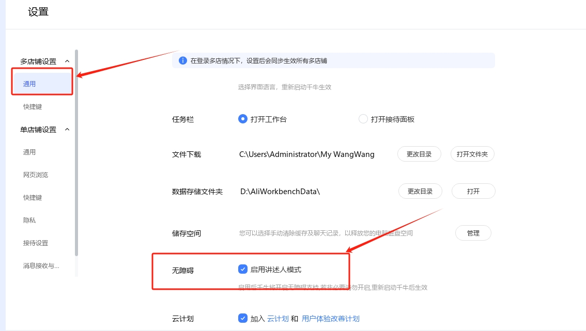
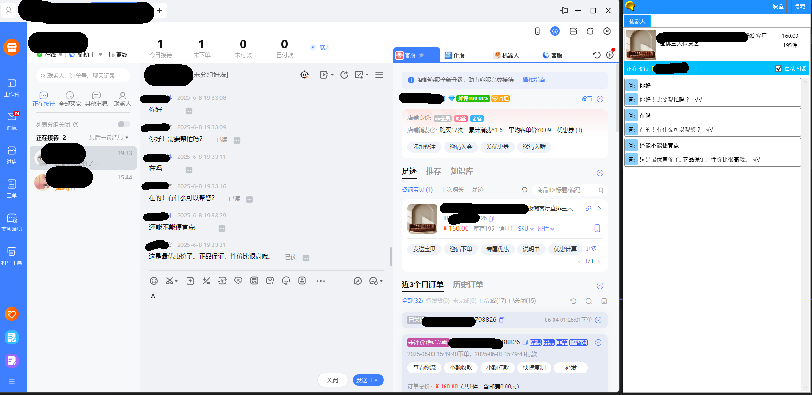
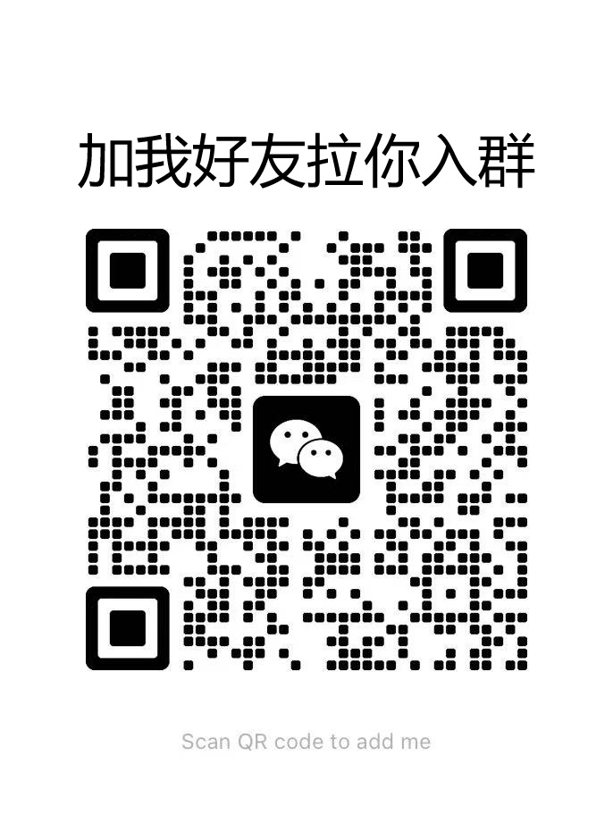

# 🚀千牛客服机器人

专为淘宝千牛打造的AI客服机器人，实现千牛7×24小时自动化值守，接入deepseek，阿里通义千问AI大模型

1. 仅支持千牛多账号模式
2. 需要打开千牛无障碍模式，如下图

  
   

### 业务功能
1. 发图文消息 
2. 自动发货
3. 催付卡片 
4. 核对卡片 
5. 转接到个人 
6. 转接到分组 

## 🎨效果图

  
   

### 环境要求
- .net framework4.8+

## 🛡 注意事项

⚠️ 注意：**本项目仅供学习与交流，如有侵权联系作者删除。**

鉴于项目的特殊性，开发团队可能在任何时间**停止更新**或**删除项目**。

## 交流群
欢迎加入项目交流群，交流技术、分享经验、互助学习。

  <table>
    <tr>
      <td align="center"><strong>微信交流群</strong></td>
      <td align="center"><strong>微信赞赏码</strong></td>
    </tr>
    <tr>
      <td></td>
      <td></td>
    </tr>
  </table>

